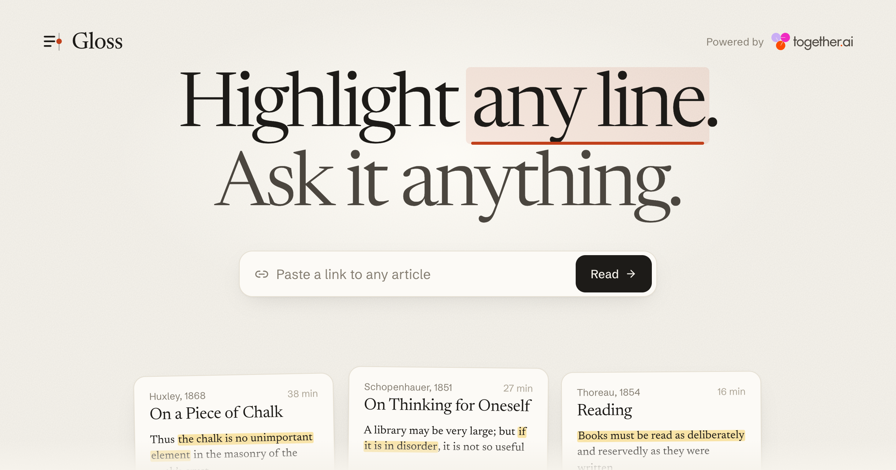

  

<h1 align="center">Gloss</h1>

A reader for articles, chapters and PDFs: select any line, start typing, and an open model writes the answer in the margin beside it, citing paragraphs you can check. <a href="https://usegloss.io">usegloss.io</a>

## Tech stack

- Next.js 16 (App Router, Turbopack), React 19, Tailwind v4, Zustand. Local-first: texts live in IndexedDB, and glosses, highlights and settings in localStorage, all in the browser and all working signed out.
- Optional accounts with Clerk. Signed in, your shelf, texts, highlights, notes, glosses and reading progress sync to Postgres on Neon (`lib/sync.ts`, `app/api/sync`); a text is fetched onto another device when it is opened there.
- Your own notes on any highlight, in the margin beside the model's (`Lens.tsx`, `Margin.tsx`). A daily review on the home page brings back five of your highlights, spaced like flashcards (`lib/review.ts`); the shelf searches every highlight and note, and exports them all as Markdown files ready for Obsidian (`lib/export.ts`, `lib/zip.ts`).
- Read aloud, off by default (Aa, then Listen): Cartesia Sonic 3 on Together, a passage at a time, fetched just ahead of the voice (`app/api/speak`, `components/reader/Listen.tsx`).
- Newsreader and Schibsted Grotesk, plus Literata and Atkinson Hyperlegible as optional reading faces; six themes, four pens and four highlighters from CSS variables, applied before first paint.
- Together AI over raw SSE fetch: DeepSeek V4.1 Flash (Quick, about 0.5s to first token) and Kimi K3 (Deep, at low reasoning effort), allow-listed in `lib/models.ts`.
- The whole text goes in the system prompt with `[¶n]` numbers, so follow-ups hit Together's prefix cache and answers cite paragraphs.
- Anchors are block id plus character offsets, rendered as React marks; margin layout and leader lines in `components/reader/Margin.tsx`.
- Import: links through `@mozilla/readability` on `linkedom` (with a private-address guard), keeping figures (by their original URL, loaded without a referrer) and data tables (which the model reads too); PDFs through `pdfjs-dist` in the browser, plus pasted text and `.txt`/`.md`.

## Cloning & running

1. Install: `npm install`
2. Add keys to `.env.local` (see `.env.example`): `TOGETHER_API_KEY` (without one, answers are labelled demo output and readers can paste their own key in the app), `DATABASE_URL` from Neon, and `NEXT_PUBLIC_CLERK_PUBLISHABLE_KEY` and `CLERK_SECRET_KEY` from Clerk
3. Create the tables: `npm run db:migrate` (safe to run again)
4. Run: `npm run dev`, open http://localhost:3100, and paste a link (or press ⌘V anywhere) or pick a card from the shelf
5. Read: select text and type to ask, `/` asks about the whole text, `j` and `k` walk paragraphs, `B` glosses the whole text, `F` is focus mode, `?` lists every key
6. Check: `npm run lint && npm run build`, then deploy with `vercel --prod` (set the same variables, plus `NEXT_PUBLIC_SITE_URL=https://usegloss.io`, in the project first)

## Roadmap

- [ ] ship it as a browser extension that opens the same margin on any page
- [ ] teach the PDF reader two-column layouts and footnotes
- [ ] let a gloss compare two passages you pick at once
- [ ] move the shared-key rate limit from memory to a store like Upstash so it holds across instances
- Accounts are skipped on purpose for now: the reader should work the second you paste a link.

## Security

`TOGETHER_API_KEY` stays server side. A key a reader pastes lives in their browser's localStorage and is sent only with their own requests. Requests on the shared key are rate limited per IP (answers and read-aloud separately: Sonic 3 costs $65 per million characters, so the shared key reads at most 60 passages an hour to each reader); link import refuses private, loopback and link-local addresses on every redirect hop.

Samples, all public domain via Project Gutenberg: Huxley, "On a Piece of Chalk" (1868); Schopenhauer, "On Thinking for Oneself" (trans. T. Bailey Saunders); Thoreau, "Reading" from Walden (1854). Rebuild them with `scripts/build-samples.mjs`; dashes are normalized to plain punctuation.
